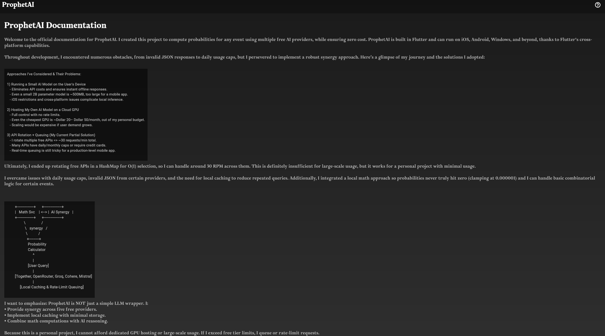

# ProphetAI

[](https://flutter.dev)  
[](https://firebase.google.com)  

## Overview  

**ProphetAI** is a web-based AI-powered probability calculator with 2000+ users that determines the likelihood of any given scenario by leveraging multiple free AI APIs. Providers are tried in a fixed order, and the first one that returns a valid four-key JSON answer wins.  

It is designed as a cross-platform **Flutter web app**, supporting both desktop and mobile devices.  

---

## 🚀 Features  

✅ **Ordered Provider Fallback** – Together → OpenRouter → Groq → Cohere → Mistral, tried in that order until one returns a valid answer.  
✅ **Four-Key JSON Contract** – Every provider must return `probability`, `short_explanation`, `paragraph_explanation` and `math_explanation`; anything else is discarded and the next provider is tried.  
✅ **Local Caching** – Answers are cached per question (SQLite on device, an in-memory map on web) and shown as *cached* in the UI.  
✅ **Dynamic UI** – Smooth animations, dark mode support, and mobile responsiveness.  
✅ **Firebase Integration** – Used for hosting and deployment.  

---

## 🛠️ Technical Architecture  

### **Frontend (Flutter Web)**  
- **Framework:** Flutter 3.29.0 (Dart >= 3.6.1)  
- **State Management:** `provider` package  
- **UI:** Built using Flutter widgets with a responsive design for mobile & desktop  
- **Networking:** HTTP requests via `http` package  

### **Provider Chain (`lib/api_service.dart`, `lib/api_config.dart`)**  
- **Order:** Providers are tried sequentially in the order listed in `APIConfig.providers` (Together, OpenRouter, Groq, Cohere, Mistral). This is an ordered fallback chain, not round-robin load balancing: the first provider is always tried first, and later ones are called only if every earlier one failed.  
- **Validation:** A response counts only if it parses as a JSON object with all four keys and a probability in (0, 1]. HTTP errors, rate limits, empty output and malformed JSON are all treated the same way: the chain advances.  
- **Cost:** A successful question calls exactly one provider; the rest are never contacted.  
- **Caching (`lib/db_service.dart`):** Results are stored per question in SQLite (`sqflite`, or `sqflite_common_ffi` on desktop) and in an in-memory map on web. A repeat question is served from the cache and labelled *(cached)*.  

---

## 📌 How It Works  

### **User Flow**  
1. User enters a question (e.g., *"What are the odds of meeting someone with the same birthday?"*)  
2. If the question is already cached, the cached answer is shown (marked *cached*) and no provider is called  
3. Otherwise the providers are tried in order until one returns a valid four-key JSON answer  
4. The probability (clamped to at least 0.000001) and the three explanations are displayed  
5. The question and result are **cached** locally  

### **Provider Fallback Chain**  




🔄 **Ordered Fallback** – Always starts at the first provider and walks the list in order  
🔄 **Failover Handling** – Any failure or contract violation moves on to the next provider  
🔄 **One Call on Success** – The chain stops at the first valid answer  

### **The Math Explanation**  
The `math_explanation` field is the model's own formula or reasoning, returned as part of the JSON contract. ProphetAI does not run its own Bayesian or Monte Carlo calculations.  

---

## 🚀 Deployment & CI/CD Pipeline  

### **Firebase Hosting**  
✅ Deployed on Firebase Hosting for **fast & scalable performance**  
✅ Uses Firebase’s **global CDN** for quick load times  
✅ Firebase CLI handles deployments  

### **GitHub Actions for CI/CD**  
🔹 **On Pull Request** (`firebase-hosting-pull-request.yml`):  
- Builds the Flutter web app  
- Deploys it to a Firebase Hosting preview channel and links it on the PR  

🔹 **On Merge to `main`** (`firebase-hosting-merge.yml`):  
- Builds the Flutter web app and deploys it to the live Firebase Hosting channel  

---

## 🛠️ Local Development Setup  

### **Prerequisites**  
- Install Flutter SDK (**Flutter 3.29.0**)  
  ```sh
  flutter --version
  npm install -g firebase-tools
  ```
- Clone the Repo
```
git clone https://github.com/DevPatel3547/ProphetAI-.git
cd ProphetAI-
```
- Running Locally
  ```
  flutter pub get
  flutter run -d chrome
  ```

## ⚠️ Limitations & Future Enhancements  

### **Current Limitations:**  
⚠️ Relies on free-tier APIs, which limits scalability  
⚠️ Requires internet connectivity  
⚠️ API responses can vary in accuracy  

### **Planned Features:**  
🚀 User authentication for personalized queries  
🚀 AI fine-tuning using user feedback  
🚀 Dedicated API backend to reduce reliance on third-party services  

---

## 🎯 Conclusion  

**ProphetAI** is an innovative **AI-driven probability calculator** that provides insights into real-world and theoretical scenarios. By walking an ordered chain of free AI APIs and accepting only answers that meet a strict JSON contract, it stays consistent and costs nothing to run. It returns one provider's estimate; it does not combine votes or claim calibration. The project is continuously evolving, with plans for enhanced **scalability & improved accuracy**.  

🔗 **GitHub Repository**: [ProphetAI](https://github.com/DevPatel3547/ProphetAI-)

